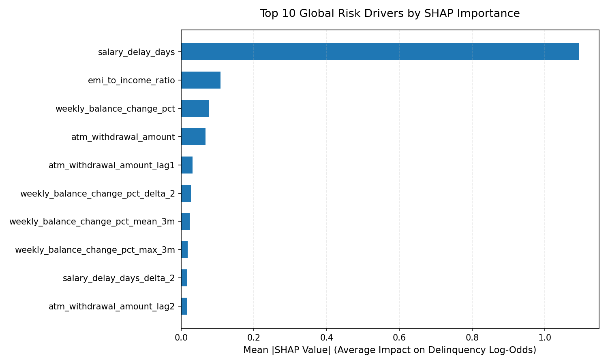
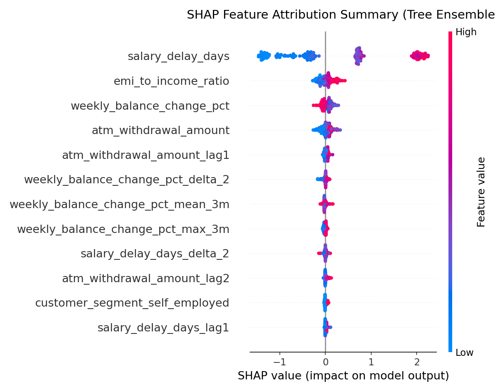
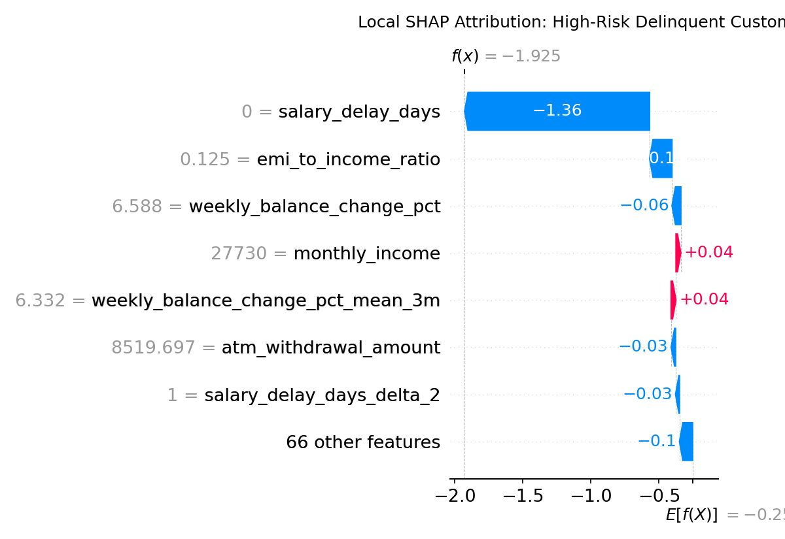

# EarlyShield — AI-Powered Pre-Delinquency Risk Engine

### Predicting financial stress before delinquency using Machine Learning and Deep Learning

EarlyShield is a machine learning-based financial risk analytics system designed to identify customers exhibiting early signs of potential delinquency.

It combines **XGBoost, LightGBM, CatBoost, PyTorch LSTM, behavioral feature engineering, probability calibration, and SHAP explainability** to analyze financial behavior and estimate delinquency risk.

The project includes an interactive **Streamlit dashboard**, model evaluation reports, and a reproducible validation pipeline.

> **Dataset:** 100% synthetic financial data. This is an educational prototype, not a production-ready credit decision system.

---

## Key Results

Results recorded by the project's validation pipeline:

| Metric | Reported result |
|---|---|
| XGBoost Test ROC-AUC | **0.8137** |
| LightGBM Test PR-AUC | **0.7222** |
| High-Recall Configuration | **93.5% recall** at threshold 0.25 |
| Calibrated Expected Calibration Error | **0.0237** |
| Behavioral Feature Space Explored | **73 features** |
| Functional Tests | **10/10 passed** |
| Optimized Preprocessing Time | **14.6 ms** |
| Estimated Preprocessing Speedup | **224×** |
| Batch Inference Throughput | **238,897 customers/sec** |

**Evaluation notes:**

- Results were obtained on a fully synthetic dataset.
- Model evaluation uses customer-grouped train, validation and test partitions.
- The 73-feature configuration was evaluated in an ablation study; it is not necessarily the feature configuration used by the deployed saved models.
- The 224× preprocessing speedup compares a measured optimized runtime against an estimated original runtime. It is not a directly measured end-to-end inference speedup.
- Results are documented in `reports/` and have not been independently reproduced outside the reported evaluation environment.

---

## Problem Statement

Traditional credit scoring often relies on static financial snapshots, which may overlook emerging changes in customer behavior.

EarlyShield explores early-warning indicators such as:

- Increasing credit utilization
- Delayed salary payments
- Rising EMI-to-income ratios
- Declining account balances
- Changes in repayment behavior
- Persistent financial stress over multiple months

By analyzing historical financial behavior, the system estimates a customer's **Probability of Delinquency (PD)** before a potential missed payment.

---

## System Architecture

```text
       Historical Financial Data
                  |
                  v
         Data Preprocessing
                  |
                  v
       Behavioral Feature Engineering
       - Lag and Delta Features
       - Rolling Statistics
       - Financial Stress Ratios
       - Persistence Indicators
                  |
          +-------+-------+
          |               |
          v               v
     Tree Models      Sequential Model
     XGBoost          PyTorch LSTM
     LightGBM
     CatBoost
          |               |
          +-------+-------+
                  |
                  v
           Ensemble Prediction
                  |
                  v
         Probability Calibration
                  |
                  v
         Delinquency Probability
                  |
          +-------+-------+
          |               |
          v               v
     Risk Category    Expected Loss
                  |
                  v
          Streamlit Dashboard
```

The validation pipeline also evaluates standalone models and alternative ensemble configurations. The reported validation-selected hybrid configuration assigned full weight to the tree ensemble, so the LSTM did not improve that configuration's final score.

---

## Machine Learning Models

| Model | Role | Test ROC-AUC |
|---|---|---|
| Logistic Regression | Baseline classifier | 0.8072 |
| Random Forest | Baseline ensemble | 0.8100 |
| **XGBoost** | Gradient-boosted decision trees | **0.8137** |
| LightGBM | Efficient gradient boosting | 0.8135 |
| CatBoost | Gradient boosting | 0.8117 |
| PyTorch LSTM | Sequential behavioral modeling | 0.8088 |
| Tree-Only Ensemble | Combined tree predictions | 0.8134 |
| Hybrid Tree + LSTM | Combined architecture evaluated | 0.8134 |

XGBoost achieved the highest standalone ROC-AUC in the reported evaluation.

The LSTM processes historical customer sequences to model temporal financial behavior.

---

## Behavioral Feature Engineering

EarlyShield explores four feature configurations:

| Feature Set | Features | Test ROC-AUC |
|---|---:|---:|
| Raw financial features | 15 | 0.8154 |
| Raw + lag/delta features | 55 | **0.8172** |
| Raw + rolling/persistence features | 33 | 0.8152 |
| Full engineered feature set | 73 | 0.8165 |

The feature-ablation study uses LightGBM to evaluate how different feature groups affect predictive performance.

### Feature Categories

**Lag features:** Previous-month financial indicators.

**Delta features:** Changes in financial indicators between periods.

**Rolling statistics:** Historical means, variability and trends.

**Persistence indicators:** Whether risk signals continue across consecutive months.

**Financial ratios:** Measures such as EMI-to-income and debt burden.

The 55-feature configuration achieved the strongest test ROC-AUC in the reported feature-ablation experiment.

---

## Model Validation and Leakage Prevention

EarlyShield includes a customer-grouped evaluation pipeline designed to prevent the same customer's records from appearing across training and testing partitions.

| Dataset | Split | Customers |
|---|---:|---:|
| Training | 70% | 10,500 |
| Validation | 15% | 2,250 |
| Testing | 15% | 2,250 |

The validation methodology separates model fitting, ensemble selection, probability calibration, and final evaluation.

Earlier evaluation leakage issues are documented in:

- `reports/data_leakage_audit.md`
- `reports/validation_methodology.md`

This separation is important because repeated observations of the same customer can otherwise inflate performance estimates.

---

## Probability Calibration

The project evaluates probability calibration to improve the interpretation of predicted delinquency probabilities.

Reported calibration results:

| Metric | Before | After |
|---|---:|---:|
| Expected Calibration Error | 0.1177 | 0.0237 |

This represents an approximately **80% reduction in ECE** in the reported experiment.

See `reports/calibration_report.md` for details.

---

## Explainable AI with SHAP

EarlyShield includes SHAP-based model explanations to help understand which financial variables influence predictions.

Generated visualizations include:

- Global feature importance
- SHAP summary plot
- High-risk customer waterfall plot
- Low-risk customer waterfall plot

### SHAP Visualizations







The existing dashboard displays pre-generated SHAP explanations. Customer-specific dynamic explanations are a future improvement.

---

## Streamlit Dashboard

The interactive dashboard supports:

- Customer selection
- Historical financial record visualization
- Current-month financial input
- Delinquency probability prediction
- Risk categorization
- Expected loss estimation
- SHAP visualization display

### Prediction Workflow

1. Select a customer.
2. Review historical financial behavior.
3. Enter current financial indicators.
4. Generate model predictions.
5. Combine and calibrate probability estimates.
6. Display the predicted risk and supporting analysis.

---

## Expected Loss Estimation

EarlyShield estimates expected financial loss using:

**Expected Loss = PD × LGD × EAD**

Where:

- **PD:** Probability of Delinquency
- **LGD:** Loss Given Default
- **EAD:** Exposure at Default

These calculations are illustrative and depend on assumed risk parameters.

---

## Performance Optimization

The project includes preprocessing and inference benchmarks.

### Preprocessing Optimization

The original rolling trend calculation used repeated polynomial fitting.

The optimized implementation uses a vectorized analytical slope calculation.

| Metric | Value |
|---|---:|
| Original preprocessing time | 3.27 s (estimated) |
| Optimized preprocessing time | 0.0146 s (measured) |
| Calculated speedup | Approximately 224× |
| Reported memory reduction | 11.3% |

### Batch Inference

The benchmark reports:

- Batch throughput: approximately **238,897 customers/second**
- Batch latency: approximately **0.004 ms/customer**

These results reflect the reported benchmark workload and hardware, not end-to-end dashboard request latency.

See `reports/optimization_comparison.md` and `reports/inference_benchmark.md`.

---

## Project Structure

```text
earlysheild/
|
├── app.py
├── predictor.py
├── model_loader.py
├── feature_engineering.py
├── risk_engine.py
├── inference.py
├── test_ui.py
|
├── content/
│   └── models/
|
├── notebook/
│   └── model_training.ipynb
|
├── sample_data/
|
├── reports/
│   ├── raw_metrics.json
│   ├── model_comparison.md
│   ├── calibration_report.md
│   ├── feature_ablation_report.md
│   ├── data_leakage_audit.md
│   ├── validation_methodology.md
│   ├── inference_benchmark.md
│   ├── optimization_comparison.md
│   └── shap/
|
├── validation_pipeline/
│   ├── execute_experiments.py
│   ├── run_functional_tests.py
│   └── run_optimization_benchmark.py
|
├── financial_stress_full_bank_grade_dataset.csv
├── requirements.txt
├── .gitignore
└── README.md
```

---

## Installation

### 1. Clone the repository

```bash
git clone https://github.com/divyamjain015/earlysheild.git
cd earlysheild
```

### 2. Create a virtual environment

```powershell
python -m venv venv
.\venv\Scripts\Activate.ps1
```

### 3. Install dependencies

```bash
pip install -r requirements.txt
```

### 4. Launch the dashboard

```bash
python -m streamlit run app.py
```

Open:

`http://localhost:8501`

**Note:** Python 3.10 was used in the reported evaluation environment. Compatible dependencies and saved model artifacts are required.

---

## Testing and Reproducibility

The repository includes validation scripts for:

- Model comparison
- Feature ablation
- Probability calibration
- Functional tests
- Preprocessing optimization
- Inference benchmarking

Reported test outcomes and methodology are available in the `reports/` directory.

The evaluation scripts and saved results are provided to support inspection and reproduction.

---

## Technology Stack

| Category | Technologies |
|---|---|
| Programming | Python |
| Data Processing | Pandas, NumPy |
| Machine Learning | Scikit-learn, XGBoost, LightGBM, CatBoost |
| Deep Learning | PyTorch |
| Explainability | SHAP |
| Dashboard | Streamlit |
| Visualization | Matplotlib, Plotly |
| Version Control | Git, GitHub |

---

## Future Improvements

- Dynamic customer-specific SHAP explanations
- FastAPI-based inference endpoints
- Docker containerization
- Model drift monitoring
- Automated retraining and CI/CD
- Real-world data validation with appropriate privacy safeguards
- Production-grade model governance

---

## Project Provenance

This repository builds upon the original pre-delinquency risk engine codebase. The original commit attribution is preserved in Git history.

Subsequent validation, documentation, benchmarking and engineering changes are tracked through repository commits.

## Disclaimer

EarlyShield is a research and educational prototype developed using **100% synthetic customer data**. Reported results are experimental and do not establish suitability for real-world credit, lending or banking decisions.
