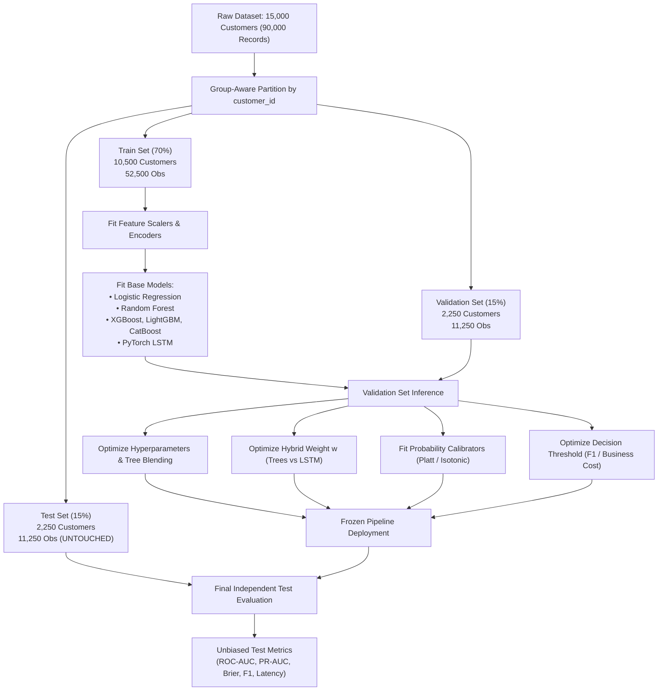

# VALIDATION METHODOLOGY ARCHITECTURE: PRE-DELINQUENCY RISK ENGINE

**Document Reference:** `reports/validation_methodology.md`  
**Date:** November 2026  
**Auditor:** Quantitative Risk Modeling & AI Systems Engineering  

---

## 1. Architectural Principles & Correction of Prior Vulnerabilities

The integrity of a financial credit risk scoring system depends on strict separation between **model parameter estimation**, **meta-parameter / ensemble optimization**, and **final unbiased generalization testing**. 

Prior iterations of this project exhibited test-set contamination: a single 20% holdout split was simultaneously employed to:
1. Benchmark tree models,
2. Search for the optimal hybrid blending weight ($w_{tree} = 0.90$),
3. Fit an `IsotonicRegression` probability calibrator, and
4. Report the headline ROC-AUC (0.825) and Brier score (0.153).

To establish an institutional-grade, statistically defensible validation architecture suitable for enterprise banking standards and technical evaluation, we implement a **Strict Group-Aware 3-Way Partition Pipeline**.

---

## 2. Partition Design: Customer-Grouped 3-Way Split

### 2.1 Why Customer-Grouped Splitting is Mandatory
Each borrower in the dataset is tracked across 6 consecutive monthly reporting periods ($T = 6$). If observations were randomly split across rows (standard shuffle-split):
- The training set would contain months 1, 2, and 4 for Customer $i$, while the test set contained months 3 and 5 for the same Customer $i$.
- Tree models and deep sequence networks would easily memorize persistent customer-specific characteristics (income level, credit limit, baseline debt-to-income ratio), inflating validation metrics artificially.
- Therefore, the partition must be strictly grouped on `customer_id`:
$$\text{Partition}(C_i) \in \{\text{Train}, \text{Validation}, \text{Test}\}, \quad \forall t \in \{1, \dots, 6\}$$
$$\text{Train} \cap \text{Validation} = \emptyset, \quad \text{Train} \cap \text{Test} = \emptyset, \quad \text{Validation} \cap \text{Test} = \emptyset$$

### 2.2 Split Proportions and Sample Allocations
We partition the 15,000 unique customers using a stratified group allocation:
- **Training Set (70%):** 10,500 unique customers ($52,500$ valid $t \to t+1$ prediction records).
- **Validation Set (15%):** 2,250 unique customers ($11,250$ valid $t \to t+1$ prediction records).
- **Test Set (15%):** 2,250 unique customers ($11,250$ valid $t \to t+1$ prediction records).

---

## 3. Clear Functional Roles of Each Partition

### 3.1 Training Set (70% / 10,500 Customers)
- **Role:** Parameter estimation and learning.
- Used exclusively for:
  1. Fitting category encoders (One-Hot Encoders).
  2. Fitting numerical feature scalers (`StandardScaler` for LSTM).
  3. Fitting baseline models (Logistic Regression, Random Forest).
  4. Fitting gradient-boosted trees (XGBoost, LightGBM, CatBoost).
  5. Training the sequential deep learning model (PyTorch LSTM).
  6. Inner cross-validation (`GroupKFold`, $k=3$) within the training partition for model stability checks.

### 3.2 Validation Set (15% / 2,250 Customers)
- **Role:** Hyperparameter selection, meta-model optimization, and post-processing calibration.
- Used exclusively for:
  1. Evaluating out-of-sample predictions of individual models.
  2. Finding optimal tree ensemble blending weights ($w_{xgb}, w_{lgb}, w_{cat}$).
  3. Optimizing hybrid blending weight $w_{tree} \in [0, 1]$ between tree ensemble and PyTorch LSTM.
  4. Fitting probability calibration models (Platt Logistic Calibration vs. Isotonic Regression).
  5. Selecting the optimal classification threshold $\tau^*$ based on explicit business utility (balancing False Positives vs. False Negatives).

### 3.3 Test Set (15% / 2,250 Customers)
- **Role:** Final independent benchmark and audit.
- **Strict Protocol:**
  - The test set is **never touched, inspected, or queried** during any stage of training, hyperparameter search, ensemble weight selection, calibration fitting, or threshold tuning.
  - All frozen model weights, chosen hyperparameters, calibrators, and decision thresholds are applied to the test partition in a single forward evaluation pass.
  - All reported headline metrics (ROC-AUC, PR-AUC, Brier score, sensitivity, specificity, MCC) originate solely from this partition.

---

## 4. Preprocessing & Temporal Leakage Safeguards

1. **Past-Only Lag & Rolling Windows:**
   - Features at month $t$ (e.g., `credit_card_utilization_lag1`, `salary_delay_persist_3m`) depend strictly on observations at months $\le t$.
   - Forward rolling windows and future target values are never accessed when constructing feature vectors.
2. **Shifted Target Definition:**
   - Target is defined strictly as `loan_default_next_month = df.groupby('customer_id')['loan_default_observed'].shift(-1)`.
   - Feature vector $\mathbf{x}_t$ predicts default occurrence $y_{t+1}$. Month 6 observations are automatically excluded from target evaluation because $y_7$ is unobserved.
3. **Transformer Fit Boundary:**
   - Categorical encodings, missing value imputations, and feature normalizations are fitted strictly on the Training set and transformed onto Validation and Test sets without refitting.

---

*This validation methodology establishes a completely defensible benchmark. Execution details follow in `reports/model_comparison.md`.*
